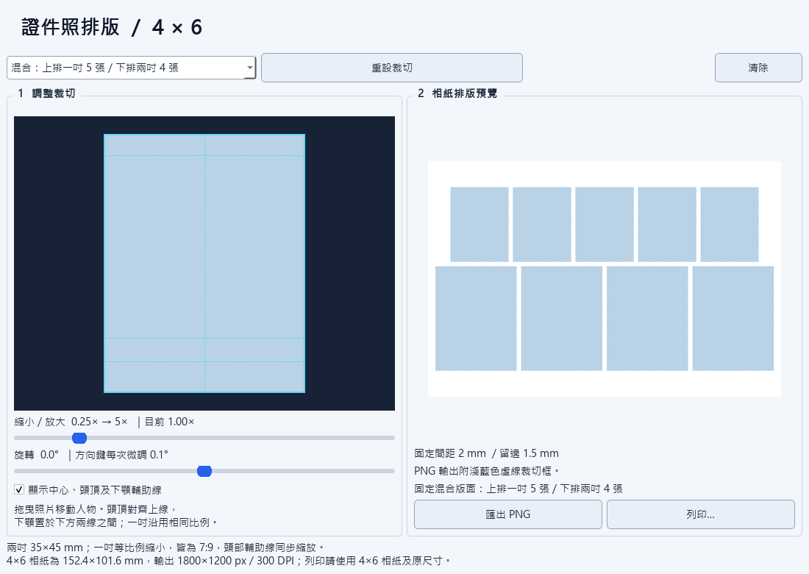

# 台灣證件照 4×6 排版 — v1.0

Windows 繁體中文證件照裁切與相紙排版工具。支援點選或拖入照片、縮放與旋轉微調，將同一份裁切照片排入 4×6 英吋相紙，匯出 PNG 或呼叫列印。



## 台灣適用規格

兩吋版面依內政部戶政司的**國民身分證照片尺寸 35×45 mm**設計，比例為 7:9；定位輔助線對應頭頂至下顎 **32～36 mm**。戶政照片另有白色背景、最近兩年內拍攝、正面彩色、五官清晰、不得修飾或使用合成照片等要求。完整要求請參閱[戶政司官方規範](https://www.ris.gov.tw/documents/html/5/3/187.html)。本程式提供人工裁切與排版，不自動判定申請資格。

本程式的「一吋」是為了保留相同人像比例而設計的 **25×32.14 mm 等比例縮小版**，不是所有台灣機構通用的一吋尺寸。若學校、公司、駕照或其他證件指定 25×35 mm 等尺寸，本程式的這個預設不適用；請以受理單位的要求為準。

| 版面 | 單張寬×高 | 每張 4×6 相紙張數 |
|---|---|---|
| 兩吋／戶政比例 | 35×45 mm | 8 張 |
| 一吋／同戶政比例縮小 | 25×32.14 mm | 14 張 |
| 固定混合 | 上排一吋、下排兩吋 | 上排 5 張＋下排 4 張 |

間距固定 **2 mm**，最小留邊 **1.5 mm**。照片保持實際尺寸並置中排版，剩餘空間為白色；實際邊緣空白可能大於最小留邊。

**本程式輸出的 4×6 PNG 是列印排版圖。** 戶政數位照片要求單張 JPG、檔案不超過 5 MB、至少寬 413×高 531 像素，因此這張排版 PNG 不能直接當成戶政線上申請照片。本程式未提供單張 JPG 申請檔輸出。

## 功能

- 固定淺色介面，支援 Windows 深色系統主題。
- 支援 JPG／JPEG、PNG、AVIF、WebP、BMP、TIFF；標準公開版本不支援 HEIC／HEIF。
- 點選左側空白裁切區選擇照片，或直接拖入檔案；已有照片時可拖入另一張替換。
- 縮放 0.25×～5×，自由拖移不受原始照片邊緣限制，空白填入純白。
- 旋轉 −30°～＋30°；點選旋轉滑桿後以左右方向鍵每次調整 0.1°。
- 中心、頭頂與下顎定位輔助線，可切換顯示，輔助線不輸出。
- 「重設裁切」恢復置中、1×、0°；最右側小型「清除」按鈕先詢問確認，預設取消。
- 每張輸出照片加上淺藍色虛線裁切框，方便裁剪。
- PNG 為 RGB、1800×1200 px、300 DPI；4×6 英吋實際尺寸為 152.4×101.6 mm。
- 匯出沿用原檔名，例如 `4x6-1吋_IMG_1234.png`、`4x6-2吋_IMG_1234.png`、`4x6-混合_IMG_1234.png`。
- 所有照片在本機處理，沒有雲端上傳、帳號系統或遙測。

圖示由 LamyFlu 提供，為 AI 生成圖片。程式沒有自動去背、美顏或人臉合格判斷；白色補空白不會把原本照片背景改成白色。

## 安裝與使用

Windows x64 使用者可從本儲存庫的 GitHub Releases 取得 1.0 版單一 EXE；不需另外安裝 Python。發布前，本機可執行檔位於 `release/ID-Photo-4x6.exe`。

1. 點選裁切區或拖入照片。
2. 選擇一吋、兩吋或固定混合版面。
3. 拖曳、縮放、微調旋轉，依輔助線定位頭部。
4. 匯出 PNG，或按「列印…」。

開發與驗證環境為 Windows 11 x64、Python 3.12。實體印表機尚未完成試印量測；列印行為仍須依自己的驅動程式確認。

## 列印

在印表機內容設定 **4×6 相紙、橫向、100% 原尺寸**，關閉自動縮放。程式會檢查驅動程式回報的紙張尺寸，並以實際尺寸送印。不可列印邊界或無邊界模式的自動擴張可能影響邊緣或照片尺寸，建議先試印並以尺量測。淺藍虛線框位於單張照片邊緣，裁剪時沿框處理。

## 從原始碼執行與編譯

先安裝 Windows x64 Python 3.12，再於專案資料夾開啟 PowerShell：

```powershell
py -3.12 -m venv .venv
.venv\Scripts\python.exe -m pip install -r requirements.txt
.venv\Scripts\python.exe src\app.py
```

驗證與打包：

```powershell
.venv\Scripts\python.exe tests\verify.py
.\build.bat
```

打包後會產生 `release/ID-Photo-4x6.exe`。固定套件版本記錄於 requirements.txt；封裝設定與 Windows 1.0 版本資訊位於 packaging/。

## HEIC 版本差異

作者在本機另保留支援 HEIC／HEIF 的 EXE、原始碼與封裝設定，放在被 Git 排除的 `.local/heic/`；這個目錄不會上傳。公開版本沒有 HEIC 解碼器，也不依賴 pillow-heif。

需要 HEIC 的使用者可依[自行編譯 HEIC／HEIF 版本](docs/BUILD_HEIC.md)安裝選用套件並修改封裝設定。該選用套件的 Windows wheel 含 GPL 元件，重新散布 HEIC EXE 前須處理額外授權要求。

## 開源與第三方授權

本專案自有原始碼、文件與圖示採 [MIT 授權](LICENSE)。PySide6／Qt、Pillow、Python 與打包工具保留各自授權；詳細資料見[第三方聲明](THIRD_PARTY_NOTICES.md)。授權文字會隨 EXE 內附，發布 ZIP 另提供可直接閱讀的副本。MIT 不覆蓋所有封裝第三方元件。

如需替換 Qt／PySide6，可在開發環境安裝或建立自己的版本，再使用同一份公開原始碼與 build.bat 重建；詳見[第三方元件與重建](THIRD_PARTY_NOTICES.md)。

## 原始碼目錄

- `src/`：GUI、裁切與排版。
- `assets/`：程式圖示。
- `tests/`：格式、裁切、旋轉、拖入、清除、排版與 PNG 驗證。
- `packaging/`：單一 EXE 封裝與版本資訊。
- `docs/`：預覽、發布說明、選用 HEIC 編譯與授權文字。
- `build.bat`、`requirements.txt`：Windows 建置入口與相依套件。

`.venv/`、`.build/`、`.archive/`、`.local/`、`release/` 為本機目錄，不提交至原始碼儲存庫。EXE 透過 GitHub Releases 發布。
